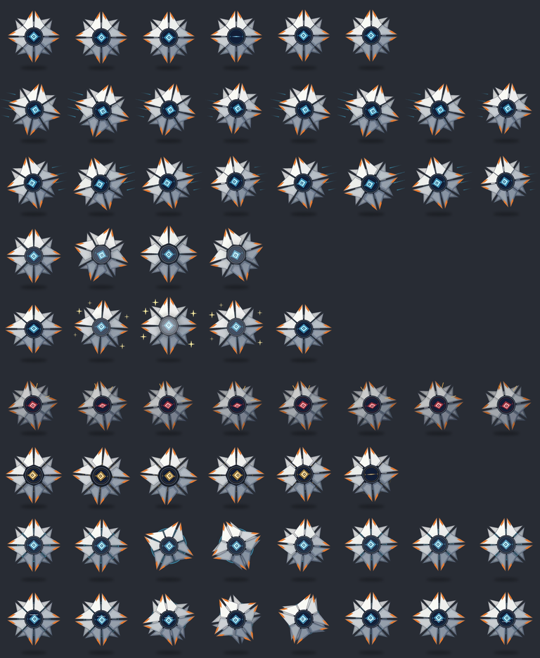

# Ghost pet for Hermes Agent

A desktop pet for [Hermes Agent](https://github.com/NousResearch/hermes-agent): a small floating companion
inspired by the Ghost from Destiny 2. Free to download and use.



## States

| Hermes state | Ghost |
|---|---|
| idle | floats gently up and down, blinks now and then |
| running / reasoning | levitates; front and back shell rings turn in opposite directions in 90° bursts |
| waiting for your input | amber eye, pupil looks around, soft pulses |
| error | red eye, dark drooping shell, sparks |
| done / celebrate | wave and jump |

## Install

```bash
mkdir -p ~/.hermes/pets/d2-ghost
cp pet.json spritesheet.webp ~/.hermes/pets/d2-ghost/
```

Then set `display.pet.slug: d2-ghost` in `~/.hermes/config.yaml` and reload the pet (or restart the desktop app).

## Regenerate

`generate.py` draws the whole spritesheet with Pillow (`pip install pillow`):

```bash
python3 generate.py [output_dir]   # default: ~/.hermes/pets/d2-ghost
```

## Disclaimer

This is an unofficial, non-commercial fan project. It is not affiliated with, endorsed by, or sponsored by
Bungie. Destiny, Destiny 2, and the Ghost character and design are the property of Bungie, Inc.; all credit
for the original concept and art goes to Bungie. The artwork here is a new, small-scale drawing made for use
as a Hermes Agent pet and contains no Bungie game assets. It will be removed on request from the rights holder.
